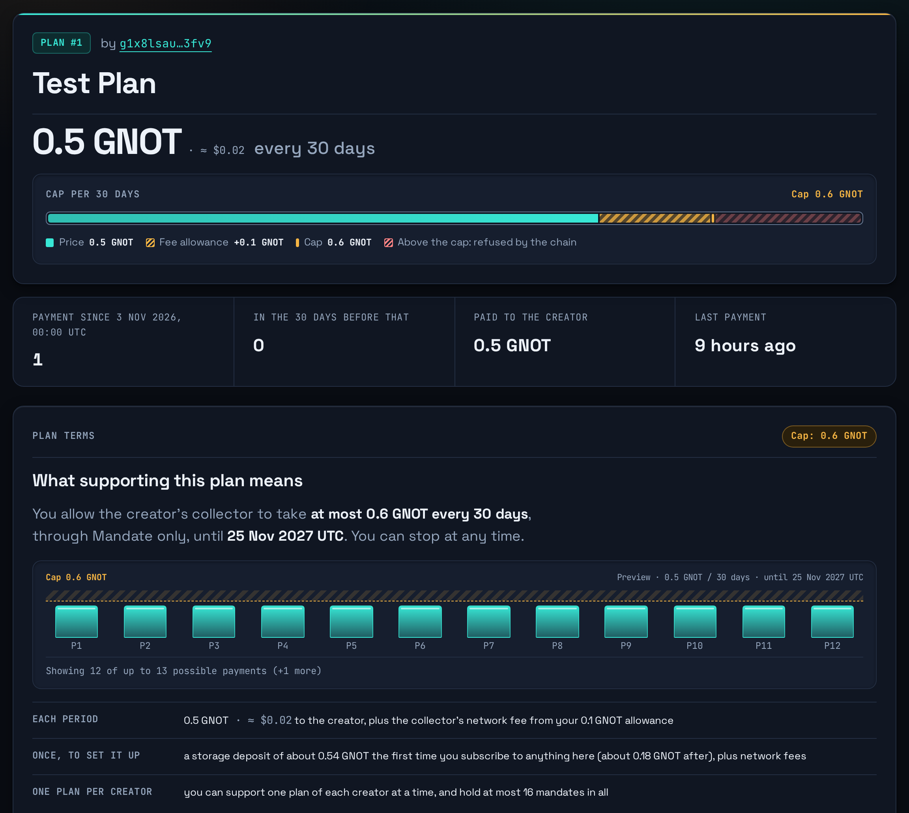

# Mandate

Mandate is subscriptions and direct debit on native GNOT, built on Gno.land session keys. A supporter signs one permission from their own wallet: *at most X GNOT every period, through this realm only, until I cancel or it expires*. The creator's collector pulls each payment when it is due; the realm checks who, how much and when, and forwards the coins to the creator in the same transaction.

## Live on Onyx

- **The site:** [elangrr.github.io/mandate](https://elangrr.github.io/mandate/): browse plans, subscribe and stop with the Adena wallet, publish as a creator.
- **Plan #1 on the site:** [elangrr.github.io/mandate/#/plan/1](https://elangrr.github.io/mandate/#/plan/1), with a real payment on chain (the collector took the first one on 2026-11-24 at 21:03 UTC, block 1385511).
- **The realm on gnoweb:** [`gno.land/r/g1llc3lq3zmjtjdk29dk52munrzxt5ne746cl7r8/mandate`](https://onyx.testnets.gno.land/r/g1llc3lq3zmjtjdk29dk52munrzxt5ne746cl7r8/mandate)
- **Every command, on the realm's help page:** [`:help`](https://onyx.testnets.gno.land/r/g1llc3lq3zmjtjdk29dk52munrzxt5ne746cl7r8/mandate:help)

The realm was deployed to the Onyx test network (`onyx-1`) on 2026-11-24, in block 1366932. The network's package approver enabled it, and since 2026-11-24 it is live: anyone can read it and use it. Test GNOT only.



## Why Gno.land

Gno v1.8.0 lets a wallet create a session: a second key it authorises, with an expiry, a list of the message paths it may sign for, and a spend limit per period that counts fees, coins sent and storage deposits ([`docs/notes.md`](docs/notes.md), "Sessions"). A Mandate permission is such a session for the creator's collector key, allowed only `vm/exec:<this realm>`, with a spend limit of the price plus a 0.1 GNOT fee allowance in each of the plan's periods. So the collector can take each payment from an ordinary GNOT wallet, without an escrow that locks funds and without a signature from the supporter for every payment. The chain enforces the cap and the scope; the realm enforces who, how much and when: `Pull` accepts only a session scoped to exactly this realm, for a recorded mandate that is active and due, and exactly the plan's price, then forwards it to the creator in the same transaction. Revoking the session in the wallet stops every payment at once.

## Try it in two minutes

### As a supporter

You need the [Adena](https://adena.app) browser wallet and test GNOT on `onyx-1`. Test GNOT comes from the Onyx faucet, listed as "Onyx Faucet" (chain `onyx-1`) on Gno.land's [Faucet Hub](https://faucet.gno.land); the networks are described in Gno.land's [network documentation](https://docs.gno.land/resources/gnoland-networks/).

1. Open [plan #1](https://elangrr.github.io/mandate/#/plan/1) and click **Connect wallet to subscribe**.
2. If Adena is on another network, click **Switch Adena to onyx-1**: the site asks Adena to switch, adding the network first if Adena does not know it.
3. Click **Subscribe for 0.5 GNOT every 30 days**. Adena asks twice:
   - **Give the permission (approval 1 of 2):** a permission (the chain calls it a session) for the creator's collector key: at most 0.6 GNOT every 30 days, through Mandate only, for one year. No payment is taken in this step.
   - **Record the terms in Mandate (approval 2 of 2):** a call to `Subscribe`, which records the mandate and takes the storage deposit. It opens only once the permission is on chain.
4. The first payment, 0.5 GNOT, is due at once; the creator's collector takes it on its next run. Your mandates, and the button to stop one, are on **My mandates**.

How much test GNOT plan #1 needs, for a wallet that has never subscribed here, at Onyx's gas price on 2026-11-25 (1 ugnot per 1,000 gas, `auth/gasprice`):

| | ugnot | From |
|---|---:|---|
| Storage deposit of a wallet's first mandate | 540,000 | `FIRST_DEPOSIT_UGNOT`, `web/app/src/lib/flows.ts` |
| Network fee, approval 1 (5,000,000 gas at the minimum price, plus half) | 7,500 | `GAS.session` and `gasFor`, `web/app/src/lib/tx.ts` |
| Network fee, approval 2 (the site's estimate for 25,000,000 gas; Adena shows the exact fee) | 25,000 | `flows.ts` |
| The first payment's cap: the price plus the fee allowance | 600,000 | plan #1's 500,000 + `feeAllowanceUgnot` 100,000, `web/app/src/config.ts` |
| **Total** | **1,172,500** | about 1.2 GNOT |

The site refuses to start below 572,500 ugnot (deposit and fees) and warns below 1,172,500 that the first payment would fail. A wallet that has subscribed here before pays a deposit of about 0.18 GNOT instead.

### As a creator

1. On the machine that will run the collector, make a separate, empty key with gnokey v1.8.0, and copy its public key (`gpub1…`) from the list:

   ```
   gnokey add -home ~/mandate-collector collector
   gnokey list -home ~/mandate-collector
   ```

   Never send coins to this key: an address that has received coins is an account, and the chain refuses to create a permission for it, so nobody new could subscribe.
2. With test GNOT in your own wallet (from the same faucet), open [`#/publish`](https://elangrr.github.io/mandate/#/publish) and click **Connect wallet to publish**. Paste the key under **Collector public key**, click **Check this key**, then **Publish collector key**. Under **Publish a plan**, fill in the title, the price per period in GNOT and the period, and click **Publish plan**. One approval each in Adena; each takes a storage deposit, which the page shows before you sign (about 0.9 GNOT for both the first time, plus network fees).
3. Open [`#/collector`](https://elangrr.github.io/mandate/#/collector) with your wallet connected: it fills in the command, to run from a clone of this repository, at least once per period of your shortest plan (the guide gives a cron line):

   ```
   scripts/collect.sh -home ~/mandate-collector -key collector -payee YOUR_ADDRESS -remote https://rpc.onyx.testnets.gno.land:443 -chainid onyx-1 -realm gno.land/r/g1llc3lq3zmjtjdk29dk52munrzxt5ne746cl7r8/mandate
   ```

## How it works

```
 creator                         supporter                         chain + realm
 ───────                         ─────────                         ─────────────
 Offer("Weekly coffee",
       1 GNOT, 7 days)  ─────────────────────────────────────────▶ plan 1 (never changes)
 SetCollectorKey(gpub K) ────────────────────────────────────────▶ key K published

                                 create a session for key K:
                                   only vm/exec:<this realm>,
                                   at most 1.1 GNOT per 7 days,   ─▶ session (supporter, K)
                                   expires in a year
                                 Subscribe(plan 1, addr(K), expiry) ▶ mandate recorded

 every 7 days, the collector signs with K on the supporter's behalf:
 Pull() sending 1 GNOT ──────────────────────────────────────────▶ chain: live session? allowed? within the cap?
                                                                   realm: right scope, active, due, exact amount
                                                   creator ◀─ 1 GNOT ─ realm (keeps nothing)
```

It ships with one thing to subscribe to: **supporter pages**. A creator publishes a plan such as "1 GNOT every week"; the plan's page lists its supporters, counted from their first payment on.

Four parts:

- **The realm** (`r/mandate`): plans, mandates, the Pull rules, the pages, free reads. No admin, no pause, no upgrade, no sweep. It never holds funds between transactions.
- **The chain's sessions** (Gno v1.8.0): the supporter's wallet creates a session for the creator's collector key, limited to this realm, with a spend limit per period and an expiry. The chain enforces the cap; the realm enforces the terms.
- **The collector** (`scripts/collect.sh`): run by the creator, holds the collector key, finds what is due through free queries (walking the creator's own plans), reads each due mandate's session on chain and skips, with the reason, one that is missing, revoked, too wide, too small or used up for the period, pulls the rest, and does not retry a refused pull before the next period. Its work per run is bounded and resumable; a revoked session is not an error.
- **The site** (`web/app`, live at [elangrr.github.io/mandate](https://elangrr.github.io/mandate/)): a static site that reads the realm through the network's public RPC and signs through the Adena wallet: browse plans, subscribe and stop, publish a collector key and plans, and the collector guide. It never asks for or handles a private key. See [`web/app/README.md`](web/app/README.md).

## The honest limits

- **It is direct debit, not escrow.** Nothing is locked up front. A supporter can revoke, cancel or empty their account at any time; a creator is only paid when a pull succeeds. Payments are taken at the start of each period, so a creator is exposed for one period at most.
- **The cap includes fees.** The session's spend limit is the price plus a fee allowance of 0.1 GNOT per period (fees and the first payment's storage deposit). A dishonest creator could burn that allowance as network fees (which go to the network, not to them). They can never take more than the limit, or pull more often.
- **At most 16 active mandates per wallet**, because the chain allows 16 sessions per account; the realm enforces it too.
- **Periods from one minute to 30 days.** The chain refuses a session whose spend period is longer than 30 days, so there are no yearly plans; a monthly plan with a one-year mandate is the longest commitment.
- **One plan of each creator at a time.** All of a creator's plans are collected by one key, and the chain allows one session per key per wallet.
- **Not charged twice for a period.** If a supporter cancels (or the creator does), renews, or comes back with another key while a period is still paid, the new mandate's first payment waits until that period ends. The exception: a wallet keeps paid time for at most 16 plans it has left; beyond that, a creator's cancel keeps nothing for its own plan, and the supporter's own cancel lets the soonest-ending period go.
- **Never send coins to a collector key.** An address that has received coins is an account, and the chain refuses to create a session for it: nobody new could subscribe. Anyone can do this to a published key with a 1 ugnot send; the creator then publishes a new key (the plan page says so), and existing supporters are unaffected.
- **Revoke any time.** Revoking the session on chain stops every payment at once. The realm cannot see a revoke, so it still shows the mandate as active until it is cancelled or expires. **To check whether a supporter has paid, use `PaidThrough(payer, plan)`** (or `IsPaidUp`): it moves only when a payment succeeds, so after a revoke it simply runs out within one period. `HasMandate` only says a mandate is recorded, which costs nothing but a deposit and says nothing about payment.
- **Nothing is ever deployed under the realm's path.** A session for `vm/exec:<realm>` also allows every realm under that path (the chain matches by prefix). The realm's deployer must never deploy anything at `gno.land/r/<namespace>/mandate/...`; this repository never will.
- **The creator needs an always-on collector** holding the collector key.
- **Subscribing costs a storage deposit** of about 0.54 GNOT the first time a wallet subscribes (the wallet's own record in the realm plus the mandate), about 0.18 GNOT for each later one, paid by the supporter, plus normal fees. Each wallet's records are its own: nothing another wallet does can make your payments or cancels dearer, except a slightly deeper tree (measured in docs/design.md).
- **Anyone can record a mandate without paying.** Supporter pages therefore list and count supporters only from their first payment on; mandates that never paid are shown as a number, never as supporters.

## Using it from the command line

The realm's help page, [`:help`](https://onyx.testnets.gno.land/r/g1llc3lq3zmjtjdk29dk52munrzxt5ne746cl7r8/mandate:help), has every command with the flags for `onyx-1`; the ones below are copied from it. Replace the words in capitals. `gnokey`'s default remote is a node on your own machine (`127.0.0.1:26657`), so always give `-remote`.

```
# creator, own key: a plan (title, price in ugnot, period in seconds), then the collector key
gnokey maketx call -pkgpath gno.land/r/g1llc3lq3zmjtjdk29dk52munrzxt5ne746cl7r8/mandate -func Offer -args "TITLE" -args 1000000 -args 604800 -gas-fee 100000ugnot -gas-wanted 60000000 -broadcast -chainid onyx-1 -remote https://rpc.onyx.testnets.gno.land:443 YOUR_KEY
gnokey maketx call -pkgpath gno.land/r/g1llc3lq3zmjtjdk29dk52munrzxt5ne746cl7r8/mandate -func SetCollectorKey -args GPUB_OF_COLLECTOR_KEY -gas-fee 100000ugnot -gas-wanted 60000000 -broadcast -chainid onyx-1 -remote https://rpc.onyx.testnets.gno.land:443 YOUR_KEY

# supporter, own key: each plan's gnoweb page shows these two filled in
gnokey maketx session create -pubkey COLLECTOR_GPUB -allow-paths vm/exec:gno.land/r/g1llc3lq3zmjtjdk29dk52munrzxt5ne746cl7r8/mandate -spend-limit PRICE_PLUS_100000ugnot -spend-period PERIOD_SECONDS -expires-at UNIX_TIME -gas-fee 100000ugnot -gas-wanted 60000000 -broadcast -chainid onyx-1 -remote https://rpc.onyx.testnets.gno.land:443 YOUR_KEY
gnokey maketx call -pkgpath gno.land/r/g1llc3lq3zmjtjdk29dk52munrzxt5ne746cl7r8/mandate -func Subscribe -args PLAN_ID -args COLLECTOR_ADDRESS -args UNIX_TIME -gas-fee 100000ugnot -gas-wanted 60000000 -broadcast -chainid onyx-1 -remote https://rpc.onyx.testnets.gno.land:443 YOUR_KEY

# creator's collector, from a clone of this repository
scripts/collect.sh -home KEYBASE_DIR -key COLLECTOR_KEY -payee YOUR_ADDRESS -remote https://rpc.onyx.testnets.gno.land:443 -chainid onyx-1 -realm gno.land/r/g1llc3lq3zmjtjdk29dk52munrzxt5ne746cl7r8/mandate [-state collector.state] [-dry-run]
```

The collector needs gnokey v1.8.0, python3 and flock (its header says so); before it starts it checks that `gnokey`, `flock` (util-linux) and `timeout` (coreutils) are on the PATH. Without `-state` it keeps its state in `${XDG_STATE_HOME:-~/.local/state}/mandate-collector`. `scripts/collect.sh -help` prints its usage, and the comments at the top of the script explain every option. Stopping a mandate, the `Pull` command itself and the free check for services are on `:help`.

### Realm API

| Function | Who | What |
|---|---|---|
| `Offer(cur, title, amountUgnot, periodSeconds) uint64` | creator, own key | Publishes a plan. |
| `SetCollectorKey(cur, gpub)` | creator, own key | Publishes the collector's public key; the realm derives its address. |
| `Subscribe(cur, planID, sessionAddr, expiresAtUnix) uint64` | supporter, own key | Records the terms for one session. The first payment is due at once. |
| `Pull(cur)` | collector, signed with the session key (`-master <supporter>`) | Exactly the price, once per period, forwarded to the creator. |
| `Cancel(cur, payer, sessionAddr)` | supporter or creator, own key | Ends a mandate in the realm. |
| `PaidThrough(payer, planID) int64`, `IsPaidUp(payer, planID) bool` | anyone, free | Until when the supporter's payments cover them (latest payment + period), kept after a cancel or an expiry; 0 if they never paid. Deliver while now < PaidThrough, with a grace equal to how often the creator's collector runs: it turns false at the due time until the next payment is taken. |
| `GetPlan` (with the number of payments in the current and the previous period), `MandateOf`, `HasMandate` (recorded and not expired: not proof of payment), `NextPullAt`, `GetPayee`, `Totals` | anyone, free | Plain values (copies). |
| `Plans` (newest first), `PlansOf` (oldest first), `MandatesOf` (newest first), `SupportersOf` (active mandates, oldest first) | anyone, free | Paged lists, at most 20 rows per page. Every read is bounded per call; the worst cases measured at 32,000 supporters are in docs/design.md, far below the node's query gas cap. |
| `CollectorPlans(payee, page)`, `CollectorScan(planID, sessionAddr, from)` | anyone, free | Plain text for the collector: a payee's plans, and a plan's active mandates for one key, 200 list entries per call with a cursor. |
| `PayingSupporters(planID, from) ([]MandateInfo, int)` | anyone, free | The plan's supporters as its page lists them: active mandates that have paid at least once, newest first, at most 20 per call, with the index to continue from. Pass -1 for the newest and stop when the cursor comes back as -1 (passing -1 again starts over). |
| `PlanCounts(planID) (paidThisPeriod, paidLastPeriod, unpaid int, unpaidExact bool)` | anyone, free | The numbers the plan page shows: payments in the plan's current counting window and in the one before (as in `GetPlan`), and active mandates that never paid among the latest 200 (`unpaidExact` is false when there were more). |
| `Render` | gnoweb | Home, `plans` (all plans), `plan/<id>` (supporter page), `payer/<addr>`, `payee/<addr>`, `help`. |

Every crossing function except Pull refuses session keys and coins and must be called directly by a user.

## Tests

Everything runs on this machine. No test talks to a public network except the read-only checks noted in `docs/notes.md` (`npm ci` downloads the site's packages).

```
export GNOHOME=<a folder for gno's caches>   # not your key folder
gno test -v ./...        # unit tests and filetests (pages, events)
gno lint ./...
gno fmt -diff ./...
scripts/local-flow.sh    # real signed transactions on a local gnodev chain (about 5 minutes)

cd web/app && npm ci     # the site
npm test                 # unit tests
npm run typecheck
npm run e2e              # end to end, on a local gnodev chain
```

- **Unit tests** (`r/mandate/*_test.gno`): terms and their limits, time and period maths at the exact boundaries, every refusal (each checked to change nothing), paging, page content, title injection, and Pull's rules through `checkPull` (the session itself cannot be signed under `gno test`). Filetests hold golden copies of every page and the events.
- **The local flow** (`scripts/local-flow.sh`): starts gnodev with chain id `dev`, creates throwaway keys in a temporary keybase (no mnemonic is printed or kept), and proves with assertions: subscribe and pull (exact balances, realm balance zero, the event); a second pull in the same period refused; wrong amounts refused; the session refused for a bank send, another realm, and for Offer/Subscribe/Cancel/SetCollectorKey; a too-wide session refused by Pull; the collector script; chain-side and realm-side expiry; a hostile creator's fee burn capped at the spend limit; revoke; the sub-path case; the creator-pays-fees two-signer variant; cancel; and 32 supporters with exactly the sessions the pages give (the 32nd first payment included) collected by the collector script, next to sessions it must skip (too small a limit, too wide, revoked) and a pull the chain refuses (not retried in the same period, exit status 0). It refuses any chain id but `dev`, passes `-remote` and `-home` to every gnokey call, and deletes the keys and stops the node on exit.
- **The site** (`web/app`): `npm test` runs the unit tests (the decoders against recorded chain responses, the transaction builders, the subscribe and stop decisions, what each kind of wallet reply means); `npm run e2e` starts a local gnodev chain (chain id `dev`, 127.0.0.1 only) with throwaway keys, builds the site for it and drives it in headless Chromium, with a stand-in for Adena that answers in Adena's reply shapes. It needs gno v1.8.0's `gnodev` and `gnokey` on the PATH and Playwright's Chromium; details in [`web/app/README.md`](web/app/README.md).
- An early spike from before the site, `web/adena-test.html`, checked in a real browser that a page can ask Adena to create and revoke a session for someone else's key; `node web/adena-test.test.mjs` still tests its request builders against Adena's source.

`docs/design.md` has the threat model (threat, who is hurt, what stops it, how it is tested), the limits and why, and measured gas and storage. `docs/notes.md` lists the Gno facts this relies on, with sources.

## Deploying and branches

`scripts/set-namespace.sh <g1 address or registered name>` replaces the placeholder in `r/` and runs the tests. Deployment is a separate, manual step by the owner of the namespace. Never deploy anything under the realm's path.

The repository has three branches:

- `master`: development, with the site (`web/app`). Its realm keeps the placeholder namespace `mandate_dev`, which the tests and the local chain flow use.
- [`onyx`](https://github.com/elangrr/mandate/tree/onyx): the deployment snapshot, branched before `web/app/` existed. Its `r/mandate/` is the same realm code as `master`'s with the namespace set by `scripts/set-namespace.sh`, byte for byte what is on chain. It has the deploy guide, [`docs/deploy.md`](https://github.com/elangrr/mandate/blob/onyx/docs/deploy.md), the checksum of every uploaded file, [`docs/deploy-checksums.txt`](https://github.com/elangrr/mandate/blob/onyx/docs/deploy-checksums.txt), and [`scripts/verify-deploy.sh`](https://github.com/elangrr/mandate/blob/onyx/scripts/verify-deploy.sh), which compares the realm on chain with the branch's `r/mandate/`, file by file, using only free queries.
- `gh-pages`: the built site, served at [elangrr.github.io/mandate](https://elangrr.github.io/mandate/).

## Licence

MIT License; see `LICENSE` and `NOTICE`. The copy published on the Gno.land network is also available under the GNO Network General Public License, version 6, as the network's terms provide. Imported Gno packages keep their own licence.

Built on [gno.land](https://gno.land).
